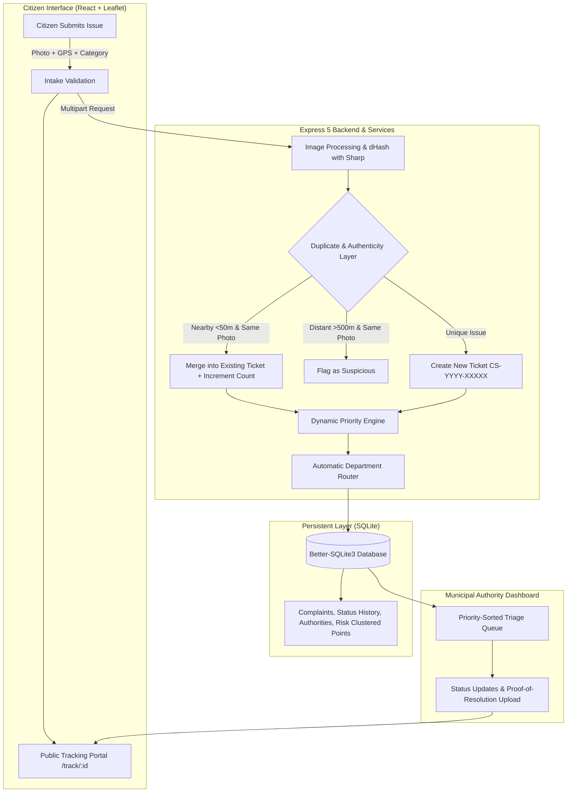

# Civic Sense 🏛️
### Intelligent Municipal Issue Reporting, Perceptual Duplicate Triaging & Public Accountability Platform

[](https://react.dev/)
[](https://nodejs.org/)
[](https://expressjs.com/)
[](https://sqlite.org/)
[](https://leafletjs.com/)
[](LICENSE)

---

## 📌 Overview

**Civic Sense** is a full-stack civic-tech platform that bridges the communication gap between citizens and municipal authorities. Traditional grievance redressal systems suffer from duplicate complaint backlogs, slow response times, and a complete lack of transparency for reporting citizens.

Civic Sense automates the complaint ingestion and triaging lifecycle using **perceptual image hashing (`dHash`)**, **geospatial proximity analysis**, and an **algorithmic priority scoring engine**—delivering real-time public issue tracking without login friction.

---

## 🌟 Key Technical Innovations

### 1. 🔍 Perceptual Duplicate Detection & Triaging Engine
- **Image Hashing (`dHash` via Sharp):** Downscales uploaded images to a 9×8 grayscale matrix to generate a 64-bit luminance difference hash.
- **Geospatial Distance (Haversine Formula):** Calculates geodesic distance between reported coordinates:
  - **Nearby (< 50m) + Hamming Distance ($\le 10$):** Automatically identifies duplicate tickets, increments the primary ticket's citizen confirmation count, and notifies the reporter without creating queue clutter.
  - **Distant (> 500m) + Identical Image:** Flags complaint as `suspicious` to prevent fraudulent or recycled photo submissions.

### 2. ⚡ Dynamic Multi-Factor Priority Scoring
Tickets are continuously prioritized using a weighted mathematical model:

$$\text{Priority Score} = (\text{report\_count} \times 10) + (\text{severity\_weight} \times 5) + (\text{days\_open} \times 2) + (\text{suspicious} \mathbin{?} -10 : 0)$$

- **Severity Weights (1–5):** Hazard-based weighting (e.g., exposed high-voltage cables = 5, potholes = 3, uncollected dry leaves = 1).
- **Automated Tiers:** `Low` (< 20), `Medium` (20–39), `High` (40–69), and `Critical` ($\ge 70$, automatically escalated for emergency dispatch).

### 3. 🗺️ Zero-Login Public Tracking & Verification
- **Instant Tracking ID:** Citizen receives a unique complaint ID (e.g., `CS-2026-00001`) with zero sign-up friction.
- **Interactive Leaflet Map:** Displays exact GPS pin coordinates, road views, and surrounding issues.
- **Democratic Auto-Reopen:** Before resolving a ticket, municipal officers must upload an "After" repair photo. If 3 citizens dispute the resolution (`Still Broken`), the ticket automatically reopens and escalates to High priority.
- **Community Endorsement ("Impacts Me Too"):** Nearby residents can vouch for an issue with 1 click, dynamically raising its priority score.

### 4. 🏢 Municipal Department Routing & Administrative Triage
- Automated complaint dispatch to specific departments:
  - **Roads & Infrastructure:** Potholes, road erosion, cracked surfaces
  - **Solid Waste Management:** Overflowing bins, illegal dumpsites
  - **Electrical & Lighting:** Dangling wires, sparking power lines, dark streetlights
  - **Horticulture & Parks:** Overgrown trees, hazardous fallen branches
  - **Animal Welfare:** Dead animal sanitary removal, aggressive strays
  - **General Municipal Cell:** Collapsed sidewalks, missing manhole covers
- Officer dashboard with status state-machine transitions (`submitted` → `under_review` → `in_progress` → `resolved` / `rejected`) and audit history logs.

### 5. 🛰️ Civic Risk Radar & AI Assistant
- **Spatial Clustering (DBSCAN 150m):** Groups nearby unresolved complaints to highlight chronic failure zones.
- **AI Assistant:** Context-aware assistant providing instant status lookups and city advisories.

---

## 🛠️ Technology Stack

| Domain | Technologies |
|---|---|
| **Frontend** | React 19, Vite, React Router 7, Leaflet, React-Leaflet, Lucide Icons, CSS3 |
| **Backend** | Node.js, Express 5, Better-SQLite3, Multer, Sharp |
| **Algorithms** | Perceptual Image Hashing (`dHash`), Hamming Distance, Haversine Geospatial Math, DBSCAN Clustering |
| **Authentication & Security** | JWT, Bcrypt.js, Express Rate Limiting |

---

## 📐 System Architecture



---

## 📂 Project Architecture

```text
Civic-Sense/
├── client/                     # Frontend React Application
│   ├── src/
│   │   ├── components/         # Shared UI components (Navbar, ChatWidget)
│   │   ├── modules/
│   │   │   ├── report/         # Intake form, camera capture, Leaflet pin
│   │   │   ├── track/          # Public status tracking & timeline
│   │   │   ├── authority/      # Official triage dashboard & risk radar
│   │   │   └── alerts/         # Municipal ward advisories
│   │   └── App.jsx
│   ├── vercel.json             # SPA routing rewrite rule for Vercel
│   └── package.json
│
├── server/                     # Backend REST API
│   ├── db/                     # SQLite schema & seed scripts
│   ├── routes/                 # Express route handlers
│   ├── services/               # Core services (duplicate.js, priority.js, routing.js)
│   ├── uploads/                # Stored complaint evidence photos
│   └── index.js                # Server entry point
│
└── package.json                # Root orchestration scripts
```

---

## 🚦 Getting Started

### Prerequisites
- Node.js (v18 or higher)
- npm (v9 or higher)

### 1. Installation

```bash
# Clone repository
git clone https://github.com/tech-tanush/civic-sense.git
cd civic-sense

# Install root dependencies
npm install

# Install server dependencies
cd server && npm install && cd ..

# Install client dependencies
cd client && npm install && cd ..
```

### 2. Environment Configuration

Create a `.env` file in the `server` directory (or copy from `.env.example`):

```bash
cp .env.example server/.env
```

Fill in your configuration:
```env
PORT=5000
JWT_SECRET=civic_sense_secure_jwt_secret_2026
OFFICIAL_EMAIL=officer@civicsense.local
OFFICIAL_PASSWORD=admin123
RISK_RADIUS_METERS=150
RISK_MIN_SIGNALS=3
```

### 3. Running Locally

Run both frontend and backend concurrently:
```bash
npm run dev
```

- **Frontend Client:** `http://localhost:5173`
- **Backend API:** `http://localhost:5000`
- **Health Check:** `http://localhost:5000/api/health`

### 4. Running Automated Tests

```bash
# API contract endpoint tests
npm run test:api

# Duplicate detection logic tests
npm run test:duplicate

# Full end-to-end citizen workflow test
npm run test:e2e
```

---

## 👤 Author

**Tanush**  
- **GitHub:** [@tech-tanush](https://github.com/tech-tanush)  
- **Repository:** [https://github.com/tech-tanush/civic-sense](https://github.com/tech-tanush/civic-sense)

---

## 📄 License

This project is licensed under the [MIT License](LICENSE).
